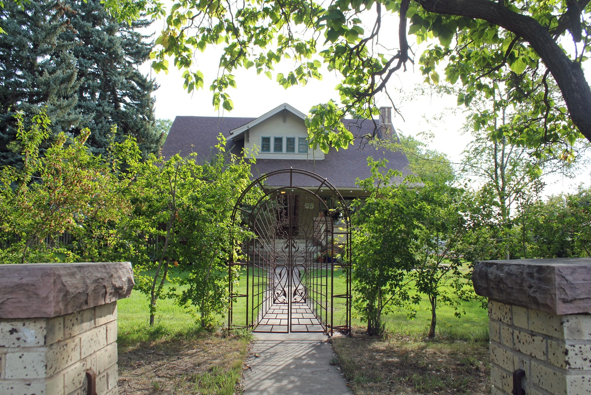

Berthoud exists because of a river crossing. Settlers came into the Little Thompson valley in the 1860s, when newcomers to Colorado Territory turned from the mining districts to homestead claims along the river, and in 1873 Lewis Cross, who had come to the territory in 1860, staked one of the first homestead claims on the banks of the Little Thompson. Cross became postmaster of the Little Thompson post office in 1875. When the Colorado Central Railroad laid its tracks across the river beside his ranch in 1877, it built a house for its section crew and derailed a boxcar to serve as a makeshift depot, and the settlement on Cross's homestead, until then known as Little Thompson, was named Berthoud, for Capt. Edward L. Berthoud, the engineer who surveyed the line.

## The town that moved

The river-bottom site was a poor one for steam locomotives, which struggled to climb out of the valley, and the railroad told the town to move to the bluff about a mile north or lose its stop. So in the winter of 1883–84 the town moved, buildings and all, to a new town site Peter Turner had platted on his homestead, and the river-bottom settlement became Old Berthoud. Within a few years the new town stretched three blocks along the tracks, with a small business district, a flour mill and 200 residents, and Berthoud incorporated in 1888.

Alfred G. Bimson built his blacksmith shop of native sandstone in 1893, the first smithy in town, and it stayed open as a smithy until 1943. Residents saved it in 1976, the Berthoud Historical Society opened it as the [Little Thompson Valley Pioneer Museum](/places/pioneer-museum/) in 1978, and it went on the National Register of Historic Places in 1981. The Society's other house, the [McCarty-Fickel Home](/places/mccarty-fickel-home/) on 7th Street, was built in 1916 by Dr. and Mrs. D.W. McCarty in the Denver Square style and still has the doctor's office from the 1930s.

## The Garden Spot

The plains around the town were dry until farmers diverted the Big and Little Thompson rivers into ditches, and irrigated fields of wheat, alfalfa, corn and sugar beets gave Berthoud the name it still puts on its welcome sign: the Garden Spot of Colorado. Sugar beets, which the Great Western Sugar Company brought to Northern Colorado in the early 1900s, quickly became the region's most important crop. Growers hauled them to rural dumping stations, where they were loaded into boxcars for the factories in Loveland and Longmont. The main hands in the beet fields were Germans from Russia and, later, workers Great Western hired from Mexico; during the Second World War, German prisoners of war worked them too. Farmsteads from those decades still stand in and around town, and three of them, the Salomonson, Swanson-Nibbelink and Lebsack-Ritter farms, opened their barns on the Historical Society's barn tour in August 2026.

*Photo: Jeffrey Beall, Wikimedia Commons, CC BY-SA 3.0*

## The highway that left

US 287 used to run through town, south on 1st Street and west on Mountain Avenue. In the summer of 2006 the highway moved onto the Berthoud Parkway, a new limited-access section along the west side of town, bypassing downtown. The bypass took the trucks off Mountain Avenue and, for a few weeks that summer, some of the customers; downtown today has breweries, a fine-art gallery, antique shops and murals, and the [downtown association](https://berthoudmainstreet.org/) that runs the calendar.

## The town that doubled

Berthoud counted 5,105 people at the 2010 census and 10,332 at the 2020 census (10,071 of them in Larimer County, 261 in Weld). Sales tax from that growth built the [Recreation Center](/places/berthoud-recreation-center/) at Waggener Farm Park, opened in November 2021; the [bike park](/places/berthoud-bike-park/), part of the same parks master plan, followed in 2023, and the Town opened [Berthoud Reservoir](/places/berthoud-reservoir-loop/) to walkers and paddlers in 2020. In 2019 the Town Board barred pet shops in Berthoud from selling dogs or cats that did not come from a shelter or rescue, to keep animals from puppy and kitten mills out of town; Fort Collins adopted a ban on the retail sale of dogs and cats in 2024.

## Sources

- [History of Berthoud and the Little Thompson Valley](https://berthoudhistoricalsociety.org/23-history/), Berthoud Historical Society: the 1860s settlers, Lewis Cross's 1873 claim and 1875 post office, the 1877 railroad, section house and boxcar depot, the name, the railroad's demand and the 1883–84 move to Peter Turner's town site, Old Berthoud, the three-block town of 200, the ditches and the Big Thompson water, wheat, alfalfa and Great Western's beets and dumping stations.
- [Berthoud history primer](https://berthoudhistoricalsociety.org/wp-content/uploads/2020/09/Berthoud-History-Primer_Printable_FINAL.pdf), Berthoud Historical Society: the move about a mile north, the 1888 vote to become a town, the crops, the Germans from Russia and Mexican workers in the beet fields, the German prisoners of war and the Garden Spot of Colorado.
- [Little Thompson Valley Pioneer Museum](https://berthoudhistoricalsociety.org/ltv-pioneer-museum/), Berthoud Historical Society, and the National Park Service's [National Register record](https://npgallery.nps.gov/AssetDetail/NRIS/81000185) and [nomination](https://npgallery.nps.gov/GetAsset/d00a06f6-62dc-4392-9547-e3c4c640a2d0) for the Bimson Blacksmith Shop: A.G. Bimson's 1893 shop of native Lyons sandstone, the first blacksmith shop in Berthoud, open until 1943; saved in 1976, a museum from 1978, listed in 1981.
- [McCarty-Fickel Home Museum](https://berthoudhistoricalsociety.org/mfh-museum/), Berthoud Historical Society: the 1916 house, the McCartys, the Denver Square style and the 1930s medical office.
- [2026 Barn Tour](https://berthoudhistoricalsociety.org/2026-barn-tour/), Berthoud Historical Society, and the National Park Service's [Gustav and Annie Swanson Farm](https://npgallery.nps.gov/AssetDetail/NRIS/05001116) record: the three farms on the August 8, 2026 tour and the Swansons' 1918 farmhouse north of town.
- [Welcome sign for Berthoud, Colorado](https://commons.wikimedia.org/wiki/File:Welcome_sign_for_Berthoud,_Colorado.jpg), a March 2021 photograph on Wikimedia Commons: "The Garden Spot of Colorado" on the town's welcome sign.
- [Historical census populations](https://storage.googleapis.com/co-publicdata/historical-census.csv), Colorado State Demography Office: the 1888 incorporation and the 2010 count.
- [US287 Asset Inventory, Chapter 7](https://nfrmpo.org/wp-content/uploads/us287-inventory-chapter-7.pdf), North Front Range MPO: the old route on 1st Street and SH 56/Mountain Avenue and the limited-access section on the western edge of town.
- [BizWest, August 4, 2006](https://bizwest.com/2006/08/04/berthoud-parkway-now-open-highway-to-move-again/) and [BizWest, February 2, 2007](https://bizwest.com/2007/02/02/berthoud-parkway-good-for-business-and-future/): the Berthoud Parkway taking US 287 out of the middle of town, its opening in the summer of 2006, and a downtown coffee house's lost and recovered business.
- [Berthoud Main Street](https://berthoudmainstreet.org/): the downtown nonprofit, its event calendar, antiques and mural tour.
- [2010](https://data.census.gov/table/DECENNIALSF12010.P1?g=1600000US0806255) and [2020](https://data.census.gov/table/DECENNIALPL2020.P1?g=1600000US0806255,1550000US0806255069,1550000US0806255123) census table P1, U.S. Census Bureau: 5,105 in 2010; 10,332 in 2020, 10,071 in Larimer County and 261 in Weld.
- [KUNC, April 22, 2021](https://www.kunc.org/news/2021-04-22/fast-growing-berthoud-eyes-completion-of-towns-first-recreation-facility): the Recreation Center at Waggener Farm Park and the growth-driven sales tax that paid for it.
- [November 2022 newsletter](https://berthoud.org/DocumentCenter/View/3516/November-Newsletter--2022), Town of Berthoud: the Recreation Center's doors first opened in November 2021.
- [Denver Gazette, September 8, 2023](https://denvergazette.com/outdoors/berthoud-bike-park/article_93d4fc30-4670-11ee-8ce7-33e1c25c2b68.html): the bike park's September 2023 opening as part of the Town's parks master plan.
- [Berthoud Reservoir Park & Open Space](https://berthoud.org/facilities/facility/details/Berthoud-Reservoir-Park-Open-Space-17), Town of Berthoud: opened to the public in 2020 with a walking trail and paddle-craft access.
- [Ordinance No. 1267](https://bestfriends.org/sites/default/files/inline-files/Berthoud%20CO%20Ord%202019%20small.pdf), Town of Berthoud, 2019: pet shops may sell dogs and cats only from a shelter or rescue.
- [Second Reading of Ordinance No. 123, 2024](https://mccmeetingspublic.blob.core.usgovcloudapi.net/fortcollco-meet-ad2ae28ac0ba488d98f63751aa2feef4/ITEM-Attachment-005-bb7f80ed5a0a4b179e1699a5d4b1cfc5.pdf), City of Fort Collins: the ban on the retail sale of dogs and cats.
