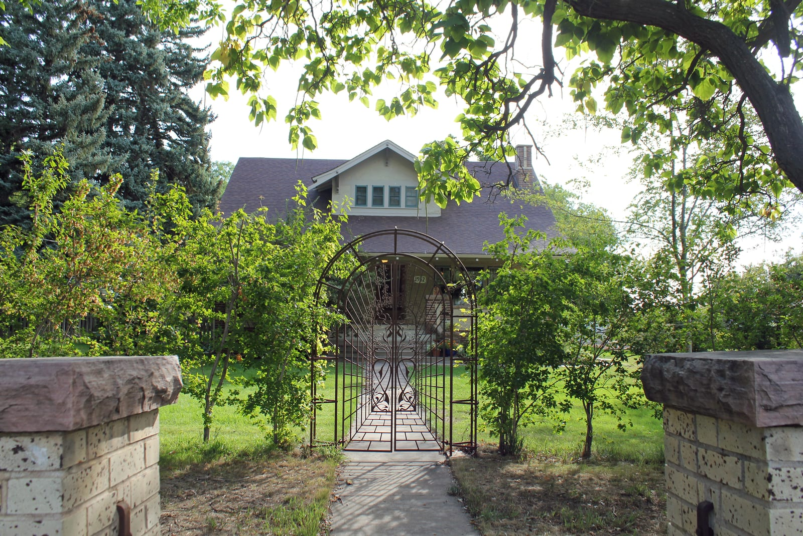

In 1877 the Colorado Central Railroad laid its tracks across the Little Thompson beside Lewis Cross's ranch. It built a house for its section crew and derailed a boxcar to serve as a makeshift depot, [according to the Berthoud Historical Society](https://berthoudhistoricalsociety.org/23-history/). The settlement on Cross's homestead, until then known as Little Thompson, was named Berthoud, for Capt. Edward L. Berthoud, the engineer who surveyed the line.

Berthoud exists because of a river crossing. The town still puts the name its irrigated fields gave it on its welcome sign: the Garden Spot of Colorado.

## Homesteads on the Little Thompson

Settlers came into the Little Thompson valley in the 1860s, when newcomers to Colorado Territory turned from the mining districts to homestead claims along the river, [the Historical Society's history says](https://berthoudhistoricalsociety.org/23-history/).

In 1873 Lewis Cross, who had come to the territory in 1860, staked one of the first homestead claims on the banks of the Little Thompson. Cross became postmaster of the Little Thompson post office in 1875.

## The move to the bluff

The river-bottom site was a poor one for steam locomotives, which struggled to climb out of the valley. The railroad told the town to move to the bluff about a mile north or lose its stop, according to [the Historical Society's history](https://berthoudhistoricalsociety.org/23-history/) and [its primer for teachers and students](https://berthoudhistoricalsociety.org/wp-content/uploads/2020/09/Berthoud-History-Primer_Printable_FINAL.pdf).

So in the winter of 1883–84 the town moved, buildings and all, to a new town site Peter Turner had platted on his homestead. The river-bottom settlement became Old Berthoud.

Within a few years, the Society's history says, the new town stretched three blocks along the tracks, with a small business district, a flour mill and 200 residents. Berthoud incorporated in 1888.

## The blacksmith shop and the McCarty-Fickel Home

Alfred G. Bimson built his blacksmith shop of native sandstone in 1893, the first smithy in town, and it stayed open as a smithy until 1943.

Residents saved it in 1976, and the Berthoud Historical Society opened it as the [Little Thompson Valley Pioneer Museum](/places/pioneer-museum/) in 1978, [the Society's page on the museum says](https://berthoudhistoricalsociety.org/ltv-pioneer-museum/). It went on the National Register of Historic Places in 1981, [according to the National Park Service](https://npgallery.nps.gov/AssetDetail/NRIS/81000185).

The Society's other museum, the [McCarty-Fickel Home](/places/mccarty-fickel-home/) on 7th Street, was built in 1916 by Dr. and Mrs. D.W. McCarty in the Denver Square style, [according to the Society's page on the house](https://berthoudhistoricalsociety.org/mfh-museum/). It still has the doctor's office from the 1930s.

## Irrigation and sugar beets

The plains around the town were dry until farmers diverted the Big and Little Thompson rivers into ditches. Irrigated fields of wheat, alfalfa, corn and sugar beets gave Berthoud the name it still puts on its welcome sign: the Garden Spot of Colorado.

Sugar beets, which the Great Western Sugar Company brought to Northern Colorado in the early 1900s, quickly became the region's most important crop, [the Historical Society's primer says](https://berthoudhistoricalsociety.org/wp-content/uploads/2020/09/Berthoud-History-Primer_Printable_FINAL.pdf). Growers hauled them to rural dumping stations, where they were loaded into boxcars for the factories in Loveland and Longmont, [according to the Society's history](https://berthoudhistoricalsociety.org/23-history/).

The main hands in the beet fields were Germans from Russia and, later, workers Great Western hired from Mexico, the primer records. During the Second World War, German prisoners of war worked them too.

Farmsteads from those decades still stand in and around town. Three of them, the Salomonson, Swanson-Nibbelink and Lebsack-Ritter farms, opened their barns on [the Historical Society's barn tour](https://berthoudhistoricalsociety.org/2026-barn-tour/) in August 2026.

*Photo: Jeffrey Beall, Wikimedia Commons, CC BY-SA 3.0*

## US 287 and the Berthoud Parkway

US 287 used to run through town, south on 1st Street and west on Mountain Avenue, [according to the North Front Range MPO's inventory of the highway](https://nfrmpo.org/wp-content/uploads/us287-inventory-chapter-7.pdf).

In the summer of 2006 the highway moved onto the Berthoud Parkway, a new limited-access section along the west side of town, bypassing downtown, [BizWest reported](https://bizwest.com/2006/08/04/berthoud-parkway-now-open-highway-to-move-again/).

The bypass took the trucks off Mountain Avenue. For a few weeks that summer it took some of the customers too, [BizWest reported later](https://bizwest.com/2007/02/02/berthoud-parkway-good-for-business-and-future/). Downtown today has breweries, a fine-art gallery, antique shops and murals, and the [downtown association](https://berthoudmainstreet.org/) that runs the calendar.

## Berthoud since 2010

Berthoud counted 5,105 people at [the 2010 census](https://data.census.gov/table/DECENNIALSF12010.P1?g=1600000US0806255) and 10,332 at [the 2020 census](https://data.census.gov/table/DECENNIALPL2020.P1?g=1600000US0806255,1550000US0806255069,1550000US0806255123), 10,071 of them in Larimer County and 261 in Weld.

Sales tax from that growth built the [Recreation Center](/places/berthoud-recreation-center/) at Waggener Farm Park, [KUNC reported](https://www.kunc.org/news/2021-04-22/fast-growing-berthoud-eyes-completion-of-towns-first-recreation-facility). It opened in November 2021, [according to the Town's newsletter](https://berthoud.org/DocumentCenter/View/3516/November-Newsletter--2022).

The [bike park](/places/berthoud-bike-park/), part of the same parks master plan, followed in 2023, [the Denver Gazette reported](https://denvergazette.com/outdoors/berthoud-bike-park/article_93d4fc30-4670-11ee-8ce7-33e1c25c2b68.html). The Town opened [Berthoud Reservoir](/places/berthoud-reservoir-loop/) to walkers and paddlers in 2020, [the Town's page on the reservoir says](https://berthoud.org/facilities/facility/details/Berthoud-Reservoir-Park-Open-Space-17).

In 2019 the Board of Trustees barred pet shops in Berthoud from selling dogs or cats that did not come from a shelter or rescue, to keep animals from puppy and kitten mills out of town, [the Town's ordinance says](https://bestfriends.org/sites/default/files/inline-files/Berthoud%20CO%20Ord%202019%20small.pdf).

## Visit these places

- **Little Thompson Valley Pioneer Museum**: Alfred G. Bimson's 1893 sandstone blacksmith shop, opened as a museum by the Berthoud Historical Society in 1978. [Museum page](/places/pioneer-museum/).
- **McCarty-Fickel Home**, on 7th Street: the Historical Society's other museum, built in 1916 in the Denver Square style, with the doctor's office from the 1930s. [Museum page](/places/mccarty-fickel-home/).
- **Downtown**: breweries, a fine-art gallery, antique shops and murals; the downtown association runs the calendar. [Berthoud Main Street](https://berthoudmainstreet.org/).
- **Berthoud Recreation Center**, at Waggener Farm Park: built with sales tax from the town's growth, opened in November 2021. [Recreation Center on this guide](/places/berthoud-recreation-center/).
- **Berthoud Bike Park**: part of the same parks master plan as the Recreation Center, opened in 2023. [Bike park on this guide](/places/berthoud-bike-park/).
- **Berthoud Reservoir**: opened by the Town to walkers and paddlers in 2020. [Reservoir on this guide](/places/berthoud-reservoir-loop/).

More on the town: [Berthoud](/).
