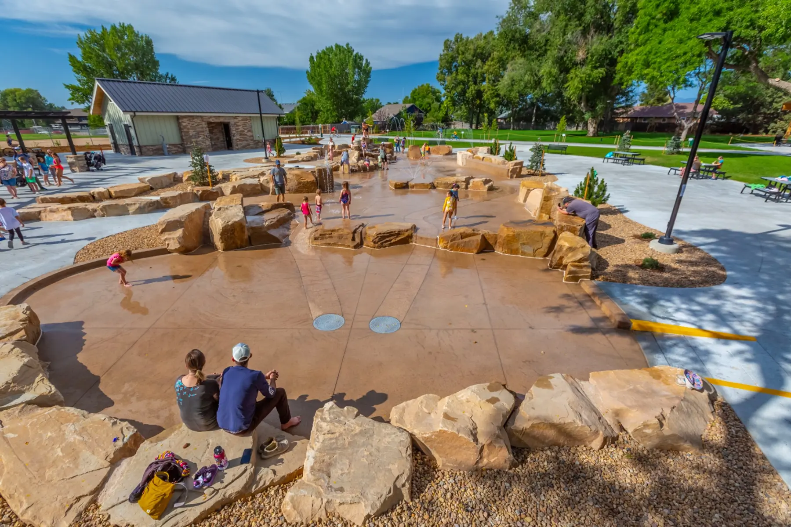

Berthoud's oldest neighborhood park, on North 7th Street downtown, rebuilt around a 12,000-square-foot fully inclusive playground and a 6,000-square-foot natural-stone water feature with 15 interactive spouts and a button-activated waterfall. The water feature runs in summer and closes for the season at Oktoberfest, on the first Saturday of October. Two rentable covered pavilions (one with a gas fire pit), a quiet Monument Garden, mature shade trees, and the lawn that hosts the [Berthoud Market](/events/) on summer Saturdays, 9 am to 1 pm, and Oktoberfest.

*Photo: Town of Berthoud*
