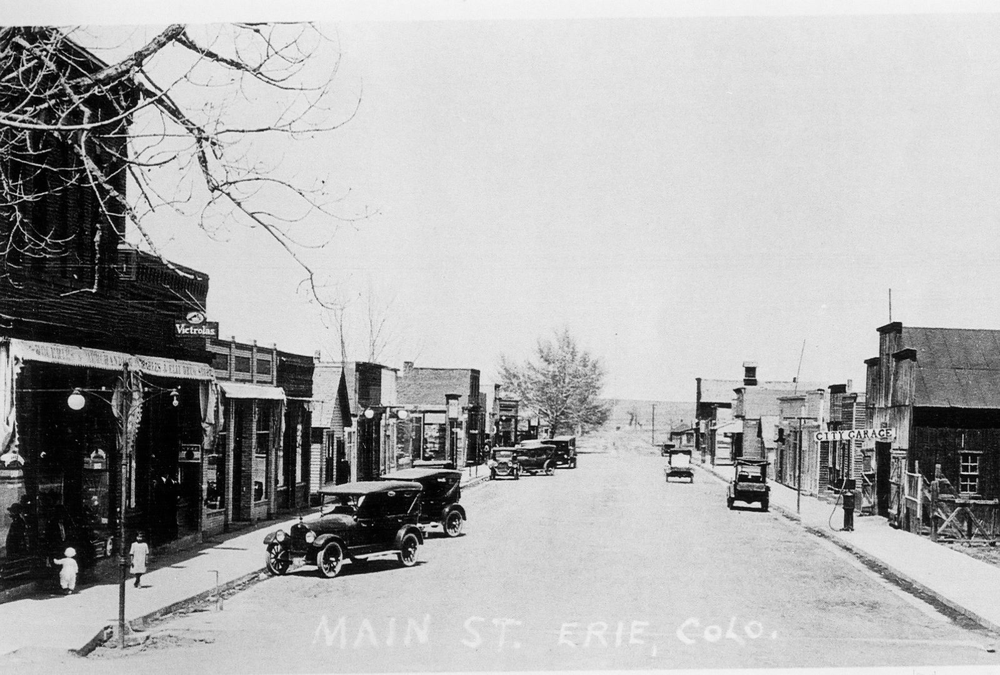
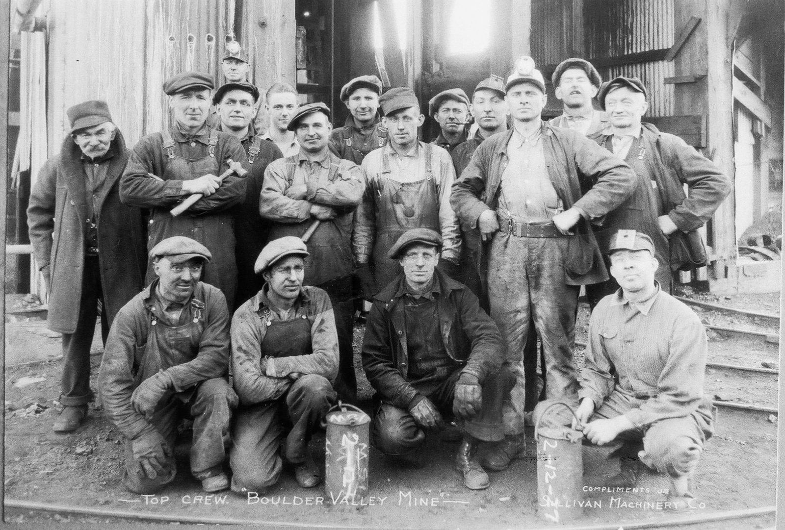
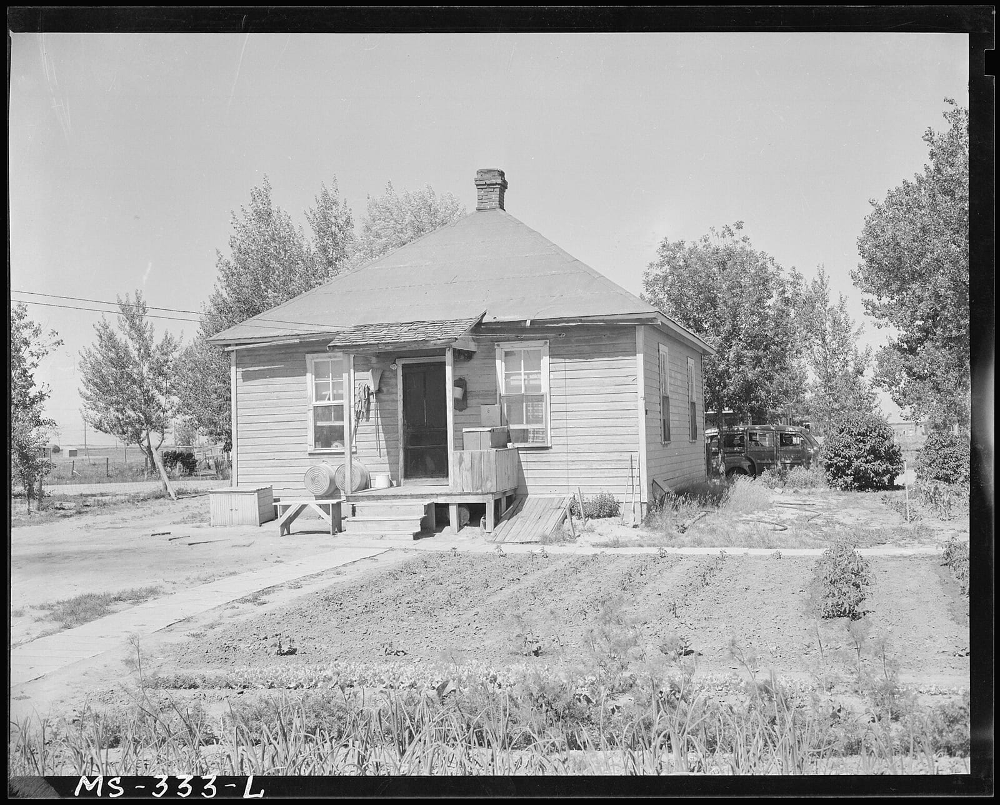
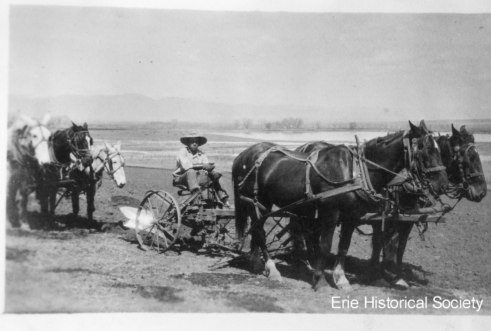

In 1876 the first official underground mine in Erie opened under Ira Austin, [according to Wikipedia](https://en.wikipedia.org/wiki/Erie,_Colorado). For the next century, until the last mine shut in 1978, Erie was, in its own description, the greatest coal mining town in Colorado.

Erie exists because of coal. Outside Town Hall, a bronze miner stands over the names of more than 500 miners on the black granite of the [Coal Miners' Memorial](/places/erie-town-hall/), dedicated on April 29, 2000, [according to its Wikimedia Commons description](https://commons.wikimedia.org/wiki/File:Erie_Colorado_Miner_Memorial.jpg).

## Settlers and the railroads

Settlers came to the Coal Creek valley after the gold rush, and coal was found in the seams under the prairie in the mid-1860s, [according to Wikipedia](https://en.wikipedia.org/wiki/Erie,_Colorado). Richard Van Valkenburg, one of the early arrivals, named the settlement for his former home of Erie, Pennsylvania.

The Denver Pacific spur reached Erie in 1870, the Denver & Boulder Valley Railroad in 1871, and the town incorporated on November 16, 1874.

## Briggs Street and the mining-era buildings

By 1895 Briggs Street had eleven saloons, [according to Wikipedia](https://en.wikipedia.org/wiki/Erie,_Colorado).

*Briggs Street looking south, on a postcard titled "Main St. Erie, Colo.", date unknown. Courtesy of the Erie Historical Society.*

The town's civic buildings are from the mining years. The two-story Davis building on Briggs Street dates from 1889, [its Wikimedia Commons description says](https://commons.wikimedia.org/wiki/File:Erie_Colorado_1889_Brick_Building.jpg), and now holds [the Old Mine](/places/the-old-mine/).

The Lincoln School on Holbrook Street is from 1906, [History Colorado records](https://www.historycolorado.org/location/lincoln-school-erie-town-hall). The City Hall with its fire bell tower is from 1930, [according to its own Commons description](https://commons.wikimedia.org/wiki/File:Old_Erie_Colorado_City_Hall.jpg).

## A century underground

Erie was the center of the Northern Coalfield, which ran from Marshall to Frederick. The mines and the camps around them drew miners from across Europe and Mexico, and their names are on the [Coal Miners' Memorial](/places/erie-town-hall/) outside Town Hall.

Puritan Camp, whose miners' homes were photographed for the federal government, was one of those camps. [Russell Lee took those photographs in 1946](https://commons.wikimedia.org/wiki/File:Home_of_miner._Puritan_Camp,_Erie,_Colorado._-_NARA_-_540361.jpg) for the Coal Mines Administration medical survey, and they are in the National Archives.

*"Top crew, Boulder Valley Mine," as the photograph is lettered; it was printed with the compliments of the Sullivan Machinery Co. Courtesy of the Erie Historical Society.*

*A miner's home at Puritan Camp, 28 June 1946. Photo: Russell Lee for the federal Coal Mines Administration survey; public domain, National Archives.*

Most of the mines closed by 1960; the last, the Eagle Mine, shut in 1978, [according to Wikipedia](https://en.wikipedia.org/wiki/Erie,_Colorado).

## The farm town

With the coal gone, Erie was a farm town of a few thousand people for the next generation, and its oldest houses tell that story too.

Oliver and Adaline Wise came from Wisconsin in 1869 and patented their homestead on Jasper Road in 1870, [according to the Erie Historical Society](https://www.eriehistoricalsociety.org/erie-wise-homestead-museum/). They built the Western Victorian farmhouse that the society opened as the [Wise Homestead Museum](/places/wise-homestead-museum/) in 2007, one of the oldest frame houses in Boulder County.

Coal Creek, which floods, got a dike after 1972.

The Lincoln School taught the town's children until 1966 and sat empty until the Town renovated it as [Town Hall](/places/erie-town-hall/) in 1998, [according to History Colorado](https://www.historycolorado.org/location/lincoln-school-erie-town-hall).

*Farming with horse teams near Erie, date unknown. Courtesy of the Erie Historical Society.*

## The town that grew by two-thirds

The 2020 census counted 30,038 people in Erie, up 66 percent from 2010, [according to Wikipedia](https://en.wikipedia.org/wiki/Erie,_Colorado). They were spread across 19.8 square miles and two counties: 17,387 in Weld and 12,651 in Boulder.

Almost all of that growth is subdivisions built on former farmland on every side of the old grid. The public buildings followed: the [Community Library](/places/erie-community-library/) in January 2008, the [Community Center](/places/erie-community-center/) and [Community Park](/places/erie-community-park/) on Powers Street, and the singletrack park.

Most recently came the Town's revitalization of Briggs Street, where the fire station became a brewery, Echo Brewing, in 2014, [5280 reported in January 2023](https://5280.com/erie-colorado-restaurants/). The block has filled with restaurants since.

## Visit these places

- **Coal Miners' Memorial**, outside Town Hall: a bronze miner over the names of more than 500 miners on black granite, dedicated on April 29, 2000. [Town Hall on this guide](/places/erie-town-hall/).
- **The Davis building**, on Briggs Street: the two-story 1889 building that now holds the Old Mine. [The Old Mine on this guide](/places/the-old-mine/).
- **Erie Town Hall**, on Holbrook Street: the 1906 Lincoln School, a school until 1966, renovated as Town Hall in 1998. [Town Hall on this guide](/places/erie-town-hall/).
- **Wise Homestead Museum**, on Jasper Road: the Wises' Western Victorian farmhouse, opened as a museum by the Erie Historical Society in 2007. [Museum page](/places/wise-homestead-museum/).
- **Echo Brewing**, on Briggs Street: the brewery in the former fire station since 2014. [Echo Brewing on this guide](/places/echo-brewing/).

More on the town: [Erie](/).
