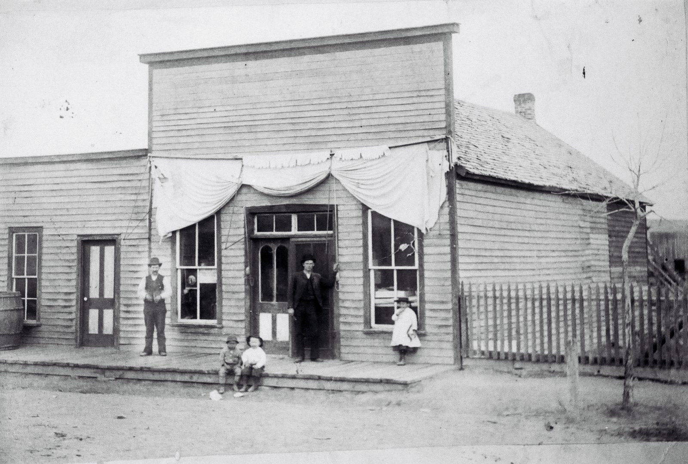
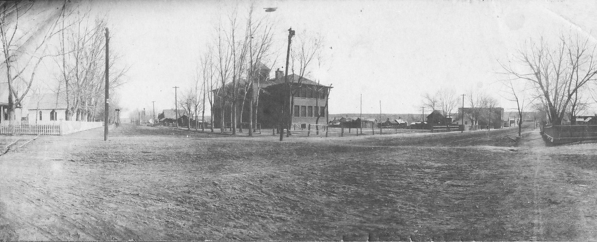
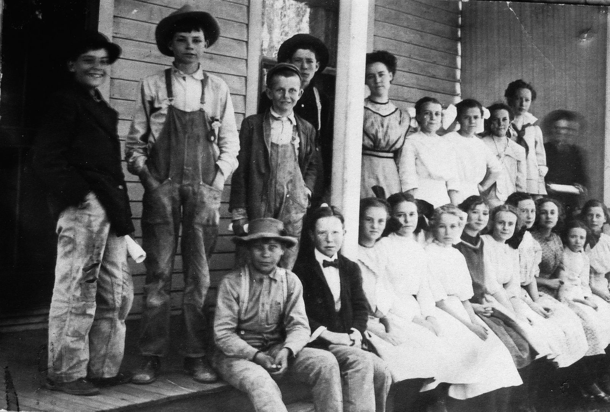
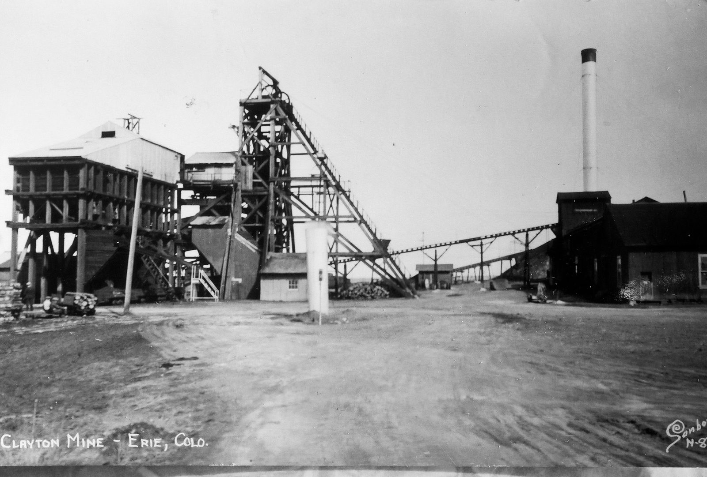
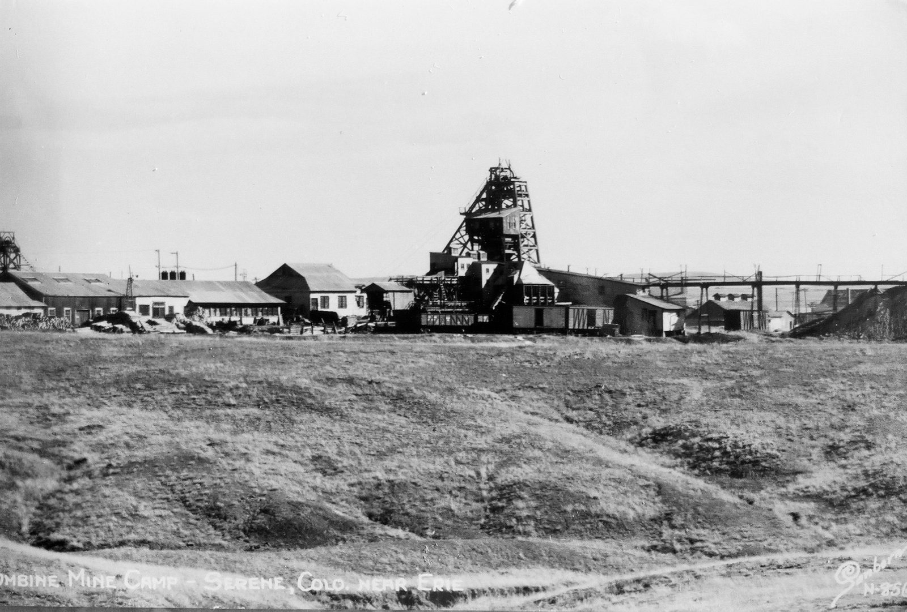
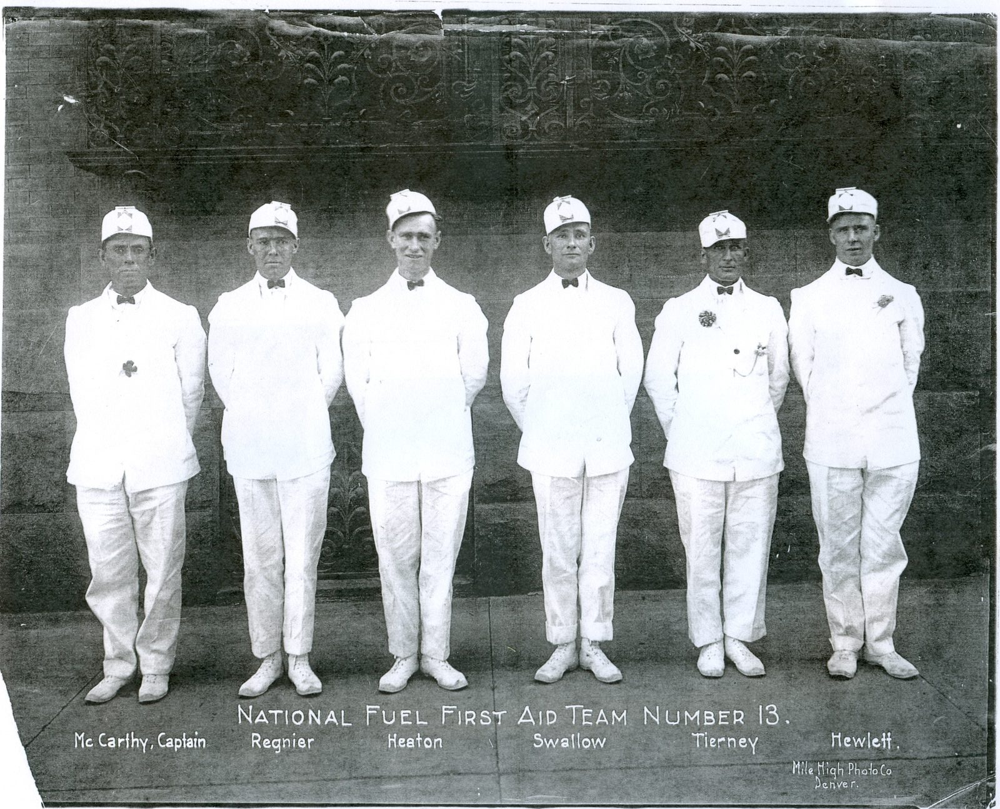

The Erie Historical Society keeps a gallery of old Erie photographs online, most of them without dates. These seven show the town's main street businesses, its school and the coal mines it was built on. Where a picture has a caption from the society, or lettering on the print, that is what we go by; we have not guessed at dates the society does not give.

## The Erie Bank

The photograph at the top of this page is the inside of the Erie Bank. The society's caption says the bank was established in 1903, on the same site as the present bank, that it survived the Depression while banks around the country were closing, and that the man pictured is James Brennan, the cashier. It comes from the Mary Young collection.

## A general store

*Thomas Richards's general merchandise store, date unknown. DeWitt Brennan collection; courtesy of the Erie Historical Society.*

Thomas Richards, the society's caption says, sold farm equipment and general merchandise to the early citizens of Erie.

## The Lincoln School

*The Lincoln School, date unknown. Courtesy of the Erie Historical Society.*

The two-story brick school on Holbrook Street was built in 1906 and was a school until 1966, according to History Colorado, which describes its hip roof, flared eaves and the bell tower over the entry. It was listed on the National Register on July 22, 1981. The building is [Erie Town Hall](/places/erie-town-hall/) today.

*Erie schoolchildren, as the society titles the photograph; the school and the year are not given. Courtesy of the Erie Historical Society.*

## The Clayton Mine

*A postcard lettered "Clayton Mine – Erie, Colo." Courtesy of the Erie Historical Society.*

Boulder Weekly lists the Clayton among the Weld County mines of the northern coal field, which once had more than a hundred mines from the southern edge of Boulder east to Dacono.

## The Columbine Mine at Serene

*A postcard lettered "Columbine Mine Camp – Serene, Colo. near Erie." Courtesy of the Erie Historical Society.*

The Columbine was the Rocky Mountain Fuel Company's mine, and Serene was its company town, with a post office from 1923 to 1942, a dance hall, a bandstand and a schoolhouse. The Town of Erie says the mine ran from 1920 to 1946, employed about 350 men and produced 7,316,275 tons of coal; a 1973 history of the 1927 strike by Perry Eberhart says it opened in 1914 and closed in 1945. On November 21, 1927, during the statewide coal strike, state police fired on striking miners at the camp's gate and six strikers were killed. The town site is inside Erie's limits and is now a landfill. Two Erie parks carry the names: [Columbine Mine Park](/places/columbine-mine-park/) on Skyline Drive and [Serene Park](/places/serene-park/) on Colliers Boulevard.

## National Fuel First Aid Team Number 13

*"National Fuel First Aid Team Number 13," lettered on the print by the Mile High Photo Co. of Denver: McCarthy, captain; Regnier; Heaton; Swallow; Tierney; Hewlett. Courtesy of the Erie Historical Society.*

The National Fuel Company ran the Eagle Mine in Erie, the last mine in town to close, and the Puritan Mine, according to photographs in the City of Lafayette's collection. The print does not say when this team was photographed or which of the company's mines its six men worked.

## See more

The full gallery is at [photos.eriehistoricalsociety.org](https://photos.eriehistoricalsociety.org/History/Eriehistoricalphotos). The society's own museum is the [Wise Homestead](/places/wise-homestead-museum/) on Jasper Road, open Saturdays 10 to 2 from May through September and by appointment.
