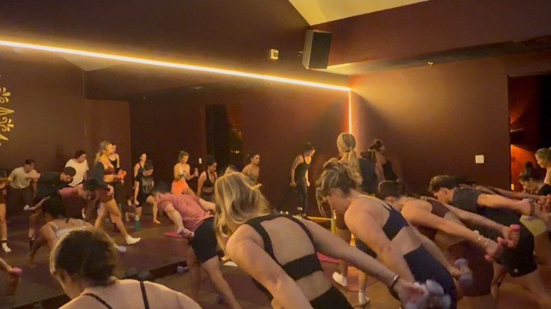
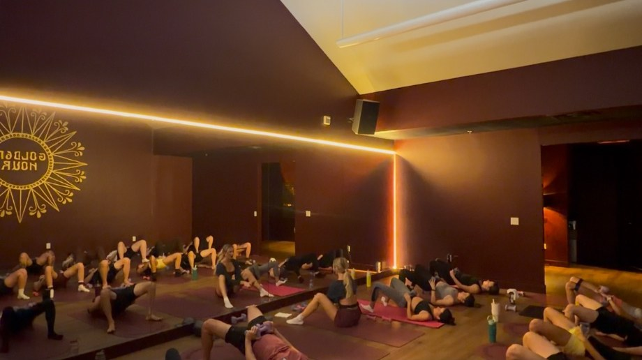

Golden Hour Pilates is a mat Pilates studio that Bailey and Christy, friends for more than 20 years, opened in 2026. It teaches two classes, both 45 minutes long. Mat Pilates is the classical kind: slow, controlled work on core strength, flexibility and alignment. Pilates Sculpt adds heavy weights, more repetitions and upbeat music. There are no reformers, and the room is not heated.

Every class is meant for all levels, and the instructors call out modifications as they go. The owners say they want everyone who comes in "to feel comfortable, strong, and confident in themselves."

*Photo: Golden Hour Pilates*

There are up to three classes a day, seven days a week, and the times change, so check the schedule before you go. Classes are booked through Walla from the Schedule link on [the studio's site](https://goldenhourpilatesco.com/), and the studio suggests booking ahead. Bring water and grip socks; the studio sells them if you have none. The door locks five minutes after class starts.

First-time clients get two weeks of unlimited classes for $59, and a drop-in class is $25. Monthly memberships are $180 for unlimited classes or $130 for eight. Students with an ID pay $130 a month for unlimited classes, and people who work for a Golden business $150.

*Photo: Golden Hour Pilates*

The studio is in the Golden Ridge Shopping Center, between the pizza place and the dry cleaner, with a large parking lot.
