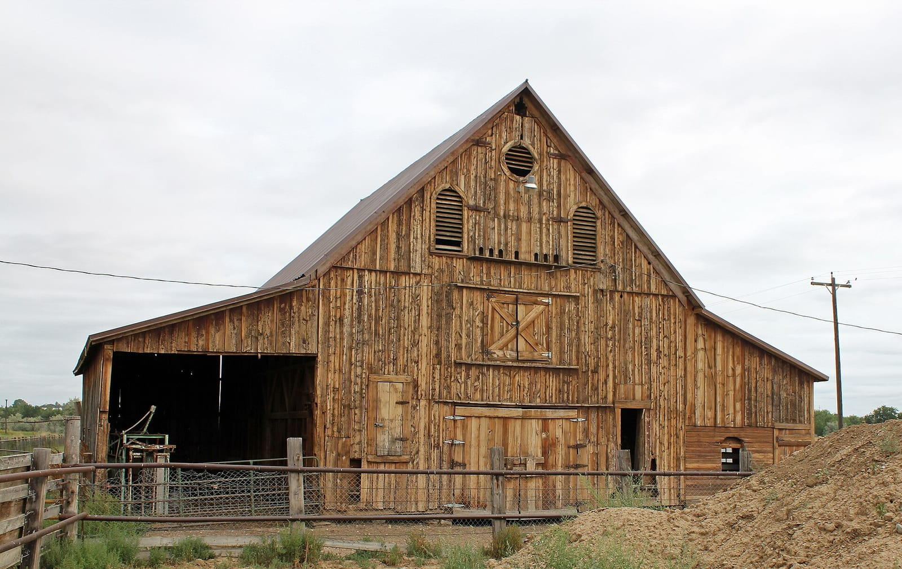
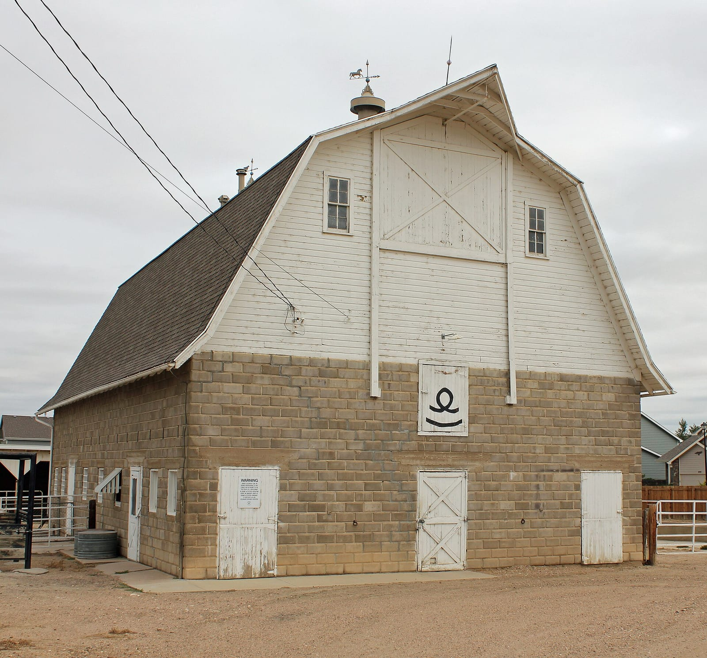

In 1902, knowing the Great Western Railway meant to build through the Little Thompson valley, Harvey J. Parish bought land at eleven dollars an acre and platted a town on it, [according to Wikipedia's article on Johnstown](https://en.wikipedia.org/wiki/Johnstown,_Colorado). His seven-year-old son John was in hospital recovering from a ruptured appendix. By the family's account, as Wikipedia gives it, Parish declared, "It will be my son's town. Let's call it John's Town."

Johnstown exists because Parish read a railroad map. Fairbairn & Parish Hardware & Lumber opened in October 1902 as the first business; the town incorporated in 1907; and John Parish grew up to serve as mayor from 1929 to 1934.

The main street, first called Greeley Avenue Public Road, is Parish Avenue now. The Craftsman bungalow Harvey and Mary Parish built on Charlotte Street in 1914 is the museum of the [Johnstown Historical Society](https://jhsco.org/).

## Two barns on the National Register

Two farm buildings outside town are on the National Register of Historic Places, and the older of them was standing nearly forty years before Parish drew his plat.

Jared L. Brush came west in the 1859 gold rush, [the Brush Barn's National Register nomination records](https://npgallery.nps.gov/pdfhost/docs/NRHP/Text/91001532.pdf). In July 1860 he and his brothers William and John gave up mining for homesteads in the Big Thompson valley, cutting the native hay and hauling it to sell in the mining camp at Central City.

In 1865 he built a barn to store it: pegged post-and-beam timbers, unpainted board-and-batten siding, a foundation of large stones. It still stands at 24308 County Road 17, about a mile northeast of town, as part of a working farm. It was listed in 1991, [Wikipedia's article on the Brush barn notes](https://en.wikipedia.org/wiki/Jared_L._Brush_Barn), as a rare Weld County barn from before the railroad.

Brush sold out to his brother John in 1870 and moved to Greeley, where he presided over the Greeley National Bank, served as county sheriff and state representative, and was twice lieutenant governor of Colorado. The town of Brush in Morgan County is named for him.

*Photo: Jeffrey Beall, Wikimedia Commons, CC BY-SA 3.0*

The second is on Colorado 60 west of town, near Johnstown Reservoir. Albert Anderson came from Sweden in 1912, [according to the Anderson Barn's National Register nomination](https://npgallery.nps.gov/NRHP/GetAsset/NRHP/04001112_text). In 1913 he built a barn with C. E. "Cement" Carlson and four young Russian immigrants, making its concrete blocks one at a time with a hand mixer; the lumber came from Fred Harsh's Johnstown lumberyard.

Its lower floor held draft horses and the family's milk cows under a hay loft, and it became a quarter-horse barn around 1990. Anderson's grandson Melvin Carlson nominated it, and it was listed in 2004, [Wikipedia's article on the Anderson Barn notes](https://en.wikipedia.org/wiki/Anderson_Barn_(Johnstown,_Colorado)), as an intact example of the ornamental concrete block that Colorado builders used from 1900 to 1940.

*Photo: Jeffrey Beall, Wikimedia Commons, CC BY-SA 3.0*

Both barns are on private, working properties and are not open to visitors.

## Sugar town

The town's first decades are the story of two factories. The Mohawk Condensed Milk Company opened in 1910 and ran for 66 years.

The Great Western Sugar Company started a factory on Colorado 60 between Johnstown and Milliken in 1920 and completed it as a refinery in 1926, according to [BizWest](https://bizwest.com/2005/10/28/johnstown-witnesses-end-of-era-as-sugar-factory-comes-down/) and [Fort Collins Images](https://fortcollinsimages.wordpress.com/2019/09/09/the-johnstown-colorado-sugar-beet-facility/). For the next 75 years the beet wagons and then the trucks came up Parish Avenue every autumn.

In its last years the plant ran as Colorado Sweet Gold, making molasses products. The equipment was auctioned and the building came down in the autumn of 2005, BizWest reported.

[The Johnstown Historical Society](https://jhsco.org/) marked the factory's centenary in 2026. [The Society's walking tour](https://jhsco.org/historicwalkingtour/) passes the survivors of those years: the 1904 Union High School, the 1904 Methodist Episcopal church, the First Baptist Church of 1908–09, the 1922 high school used until 1967 and the 1928 Masonic Temple, and the site of the Giesler Opera House, built in 1914 and pulled down in 1935.

## The Johnstown meteorite

On the afternoon of July 6, 1924, about two hundred mourners at a funeral at the Dilley Chapel in Elwell, the farm hamlet next to Johnstown, heard four explosions and watched a fiery object with a smoke trail come down out of the sky, [UCHealth Today recounts](https://www.uchealth.org/today/johnstown-meteorite-disrupts-funeral-in-1924/).

A neighbor dug the first fragment, just under twelve pounds, out of the ground while the service went on. A farmer named George Walker found the main mass a week later, nearly 52 pounds and six feet deep.

Twenty-seven pieces were recovered across ten miles toward Mead. The Johnstown meteorite is a diogenite, a piece of the asteroid Vesta about as old as the Earth, one of only five meteorites ever seen to fall in Colorado. The main mass is at the American Museum of Natural History in New York.

A small piece is in the Parish House, [according to the Johnstown Historical Society](https://jhsco.org/).

## Boomtown

Johnstown was a farm and factory town of a few thousand people for most of a century. Its population was 9,887 in 2010, [according to Wikipedia's article on the town](https://en.wikipedia.org/wiki/Johnstown,_Colorado).

Then the interchange at I-25 and US 34, branded 2534, filled in. Scheels opened its 250,000-square-foot store there in September 2017 and became the town's largest employer, and the Candlelight Dinner Playhouse and Johnstown Plaza grew up around it.

In March 2024 Colorado's first Buc-ee's opened at I-25 and County Road 48, [Colorado Public Radio reported](https://www.cpr.org/2024/03/18/first-colorado-buc-ees-location-is-now-open-in-johnstown-on-i25/).

The 2020 census counted 17,303 people. The Census Bureau's estimate for July 2025 was 22,433, an 8.4 percent rise in a single year that ranked Johnstown tenth in the nation for growth among places of 20,000 or more, according to [KUNC and BizWest](https://www.kunc.org/news/2026-05-18/from-buc-ees-to-boomtown-johnstowns-growth-goes-national) and [K99](https://k99.com/johnstown-population-growth/).

The town adopted a home-rule charter in 2006 to manage that growth, and created a Downtown Development Authority in 2026 to make sure Old Town keeps up.

## Visit these places

- **Parish House**, on Charlotte Street: the Craftsman bungalow Harvey and Mary Parish built in 1914, now the Historical Society's museum, with a small piece of the Johnstown meteorite. [Museum page](/places/parish-house-museum/).
- **The Historical Society's walking tour**: past the 1904 Union High School, the 1922 high school, the 1928 Masonic Temple and the other survivors of the town's first decades. [Walking tour on this guide](/places/old-town-walking-tour/).
- **Parish Avenue**: the main street, first called Greeley Avenue Public Road, where the beet wagons and then the trucks came every autumn for 75 years.
- **Scheels**, at the I-25 and US 34 interchange: the 250,000-square-foot store that opened in September 2017 and became the town's largest employer. [Scheels on this guide](/places/scheels/).
- **Buc-ee's**, at I-25 and County Road 48: Colorado's first, opened in March 2024. [Buc-ee's on this guide](/places/buc-ees/).

More on the town: [Johnstown](/).
