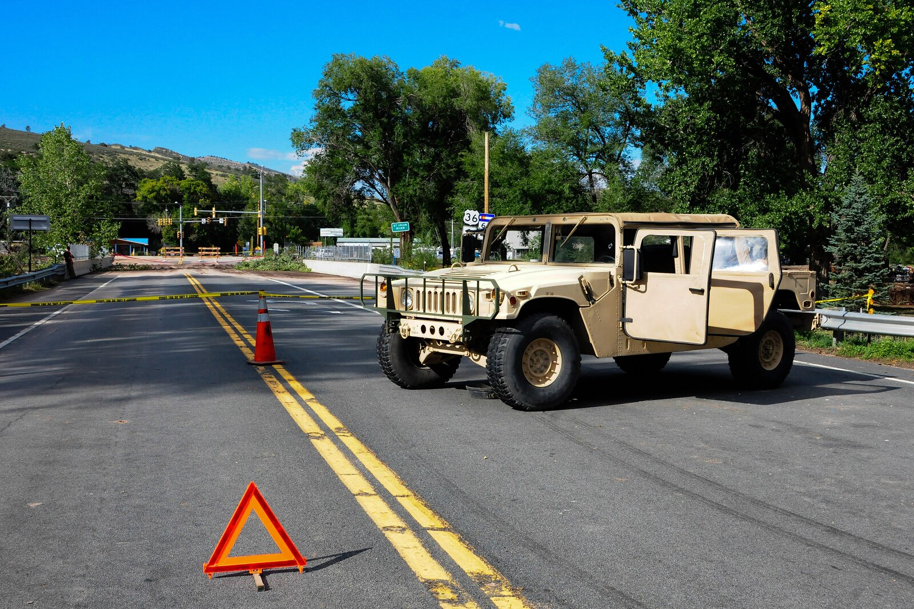

Edward S. Lyon saw the sandstone in 1880, bought 160 acres at the confluence of the North and South St. Vrain, and platted a town to sell it. Lyons exists because of that rock. The Lyons Formation, a band of Permian sandstone that runs along the Front Range, breaks here into flat, even, red-pink slabs that split cleanly and weather hardly at all.

What the quarries started, the canyons kept going: Lyons is the last town before the mountains on two highways, and for a century it has lived on people passing through to Estes Park and, lately, on people stopping. The river that made the town site has twice tried to take it back.

The buildings on [Main Street](/places/main-street/) are made of the rock; so are the University of Colorado campus in Boulder and flagstone patios across the country.

## The confluence and Edward Lyon

The St. Vrain valleys were Arapaho and Cheyenne country, with Ute bands crossing from the mountains, [according to the Lyons Redstone Museum](https://www.lyonsredstonemuseum.com/). The Fort Laramie Treaty of 1851 acknowledged the land between the Platte and the Arkansas as theirs.

Ceran St. Vrain's trading post on the plains gave the creeks their name in the 1830s. Ranchers and a few gold-seekers came up the canyons after 1859, but no town stood at the confluence until the sandstone was noticed.

Edward S. Lyon, from Connecticut, bought 160 acres at the confluence in 1880 and platted the town in 1881, naming it for himself, [Wikipedia's article on Lyons says](https://en.wikipedia.org/wiki/Lyons,_Colorado). The quarries opened on the hogbacks around it, and the school, a two-storey block of the same stone, went up the same year. That schoolhouse is the [Redstone Museum](/places/lyons-redstone-museum/) today.

## The railroad and incorporation

The Denver, Utah & Pacific reached the quarries in 1884, and the stone depot on Broadway opened in 1885, later a Burlington line, [according to the Town of Lyons](https://www.lyonscolorado.com/). Sandstone left by the trainload for Denver, Boulder and the Midwest, and the town filled with quarrymen, many of them Welsh, Cornish, Swedish and Italian.

The depot worked until the 1960s, went on the National Register in 1974 and served as the town library from 1977 until the 2013 flood.

Lyons incorporated as a statutory town in 1891 with a mayor and board of trustees, the form it keeps. The Old Stone Congregational Church of 1894 and a run of Main Street commercial blocks date from the boom that followed.

Fifteen of the town's sandstone buildings of the 1870s to 1917 are listed together on the National Register of Historic Places. The Town's Historic Preservation Commission oversees the listed buildings.

## Cement and flagstone

Portland cement and concrete undercut building stone around 1910 and the big quarries closed. The rock came back in the 1930s as decorative flagstone and veneer, and it is still cut in the hills around town today, on a smaller scale, and shipped worldwide.

The town settled into being the last stop before Estes Park.

## The Historical Society, the depot and the museum

Residents formed the Lyons Historical Society in 1973 to stop the depot being sold and trucked out of town, [the Lyons Redstone Museum records](https://www.lyonsredstonemuseum.com/), and the society bought it with the Town and restored it. In 1979 the society opened the Redstone Museum in the old school.

RockyGrass, the bluegrass festival that would settle at [Planet Bluegrass](/places/planet-bluegrass/) on the west edge of town, dates from the same decade.

## Beer, art and a downtown award

[Oskar Blues](/places/oskar-blues-grill-brew/) opened as a Cajun restaurant on Main Street in 1997 and in 2002 became the first American craft brewery to put its beer in cans, a decision that changed the industry and made the town's name known far outside Colorado.

The Arts & Humanities Commission began placing sculpture around town, and the annual studio tour started in 2004. In 2016 the restored Depot won a Governor's Award for Downtown Excellence for best adaptive reuse, [the Town of Lyons announced](https://townoflyons.com/CivicSend/ViewMessage/message/25591).

## The 2013 flood

After a week of rain, both forks of the St. Vrain rose on the night of September 11 to 12, 2013 and met in the middle of town, [according to Wikipedia's article on the 2013 Colorado floods](https://en.wikipedia.org/wiki/2013_Colorado_floods). Every road in was cut, the water, sewer and power went, and the National Guard evacuated residents by convoy and helicopter.

*The Colorado National Guard's checkpoint at the St. Vrain bridge into Lyons, 16 September 2013. Photo: Staff Sgt. Dixie Manzanares, Colorado National Guard; public domain.*

About a fifth of the housing was lost or badly damaged, and the parks and the depot library were wrecked. It took years of federal, state and Town money to rebuild the utilities, bridges and riverbanks.

[LaVern M. Johnson Park](/places/lavern-m-johnson-park/) reopened in 2017 and the library moved into a new building in 2019.

## Lyons today

The 2020 census counted 2,209 people in Lyons, in 1.36 square miles. The downtown is an accredited Main Street America program and a state Creative District; about 97% of its businesses are independently owned.

Two festivals, two breweries, a distillery, a tiny-home resort and a mountain-bike trail keep the through-traffic stopping, and the quarries on the hogbacks are still working.

## Visit these places

- **Main Street**: its buildings are made of the Lyons sandstone, and a run of its commercial blocks dates from the boom after the town incorporated in 1891. [Main Street on this guide](/places/main-street/).
- **Lyons Redstone Museum**: the 1881 schoolhouse, a two-storey block of the same stone, where the Lyons Historical Society opened the museum in 1979. [Museum on this guide](/places/lyons-redstone-museum/).
- **The Depot**, on Broadway: the 1885 stone depot, listed on the National Register in 1974, which the Lyons Historical Society bought with the Town and restored.
- **Old Stone Congregational Church**: the church of 1894, from the boom that followed incorporation.
- **Planet Bluegrass**, on the west edge of town: where RockyGrass, the bluegrass festival, settled. [Planet Bluegrass on this guide](/places/planet-bluegrass/).
- **Oskar Blues**, on Main Street: opened as a Cajun restaurant in 1997, and in 2002 the first American craft brewery to put its beer in cans. [Oskar Blues on this guide](/places/oskar-blues-grill-brew/).
- **LaVern M. Johnson Park**: reopened in 2017 after the 2013 flood. [Park on this guide](/places/lavern-m-johnson-park/).

More on the town: [Lyons](/).
