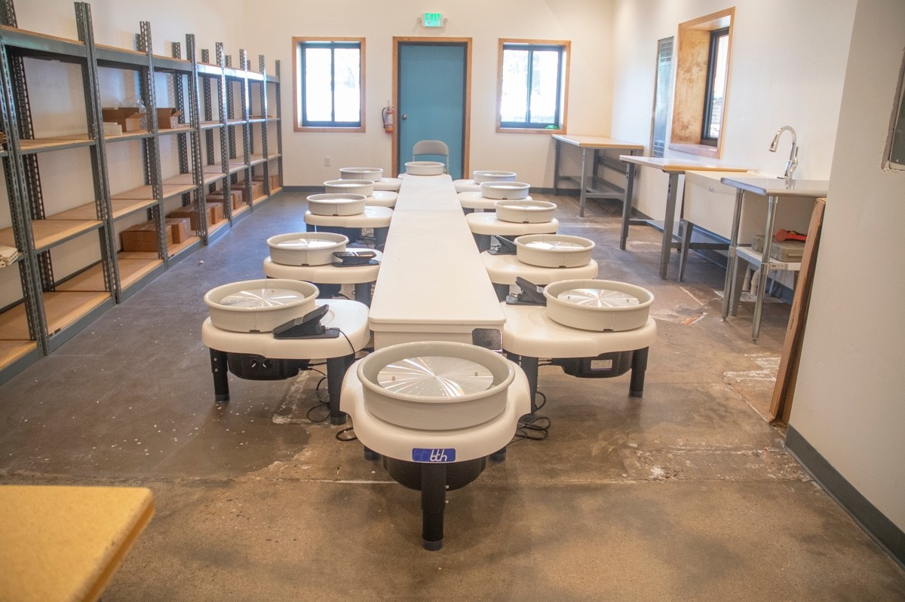
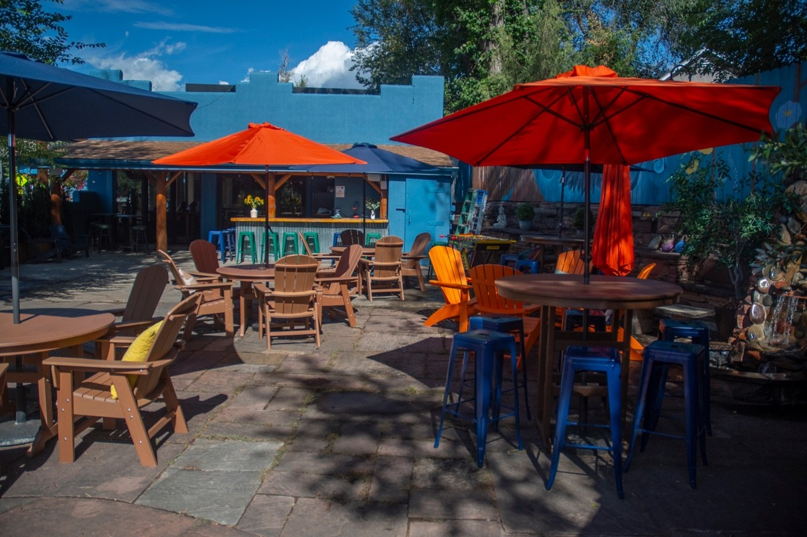

Creative Grounds calls itself a nonprofit café, art studio and third space for youth. The café pours coffee roasted by Ozo, makes its own syrups, and makes its pastries and sandwiches fresh each day. There are games, books and rock painting for kids and adults. Wednesday to Sunday, 8 am to 4:30 pm.

*Photo: Creative Grounds*

The pottery studio runs classes through mid-December: five-week wheel-throwing and handbuilding courses for adults and teens, and one-time Fun Friday classes for teens and young adults, $30 each. Every class is on [the events page](/events/) with its dates, and you sign up on [Creative Grounds's class page](https://creativegroundslyons.com/classes).

*Photo: Creative Grounds*
